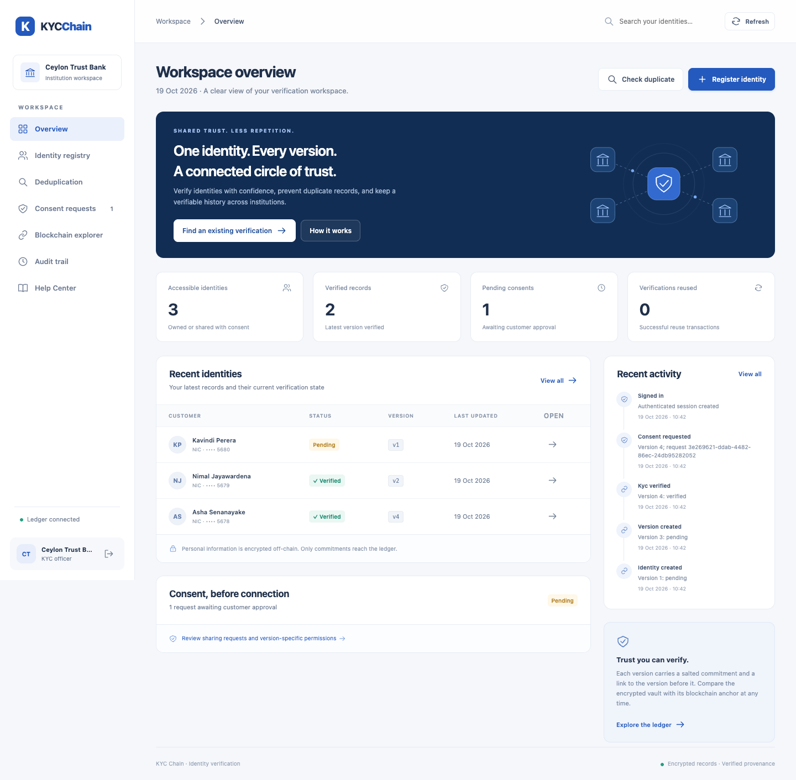
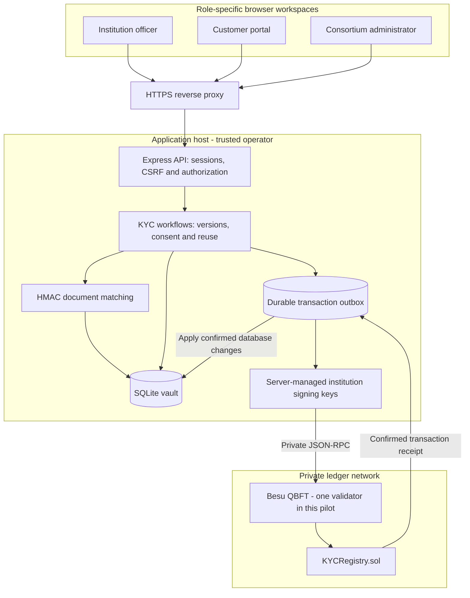
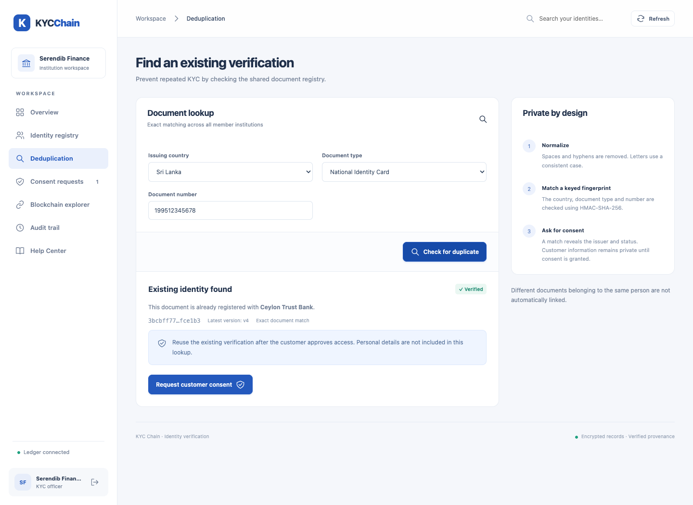
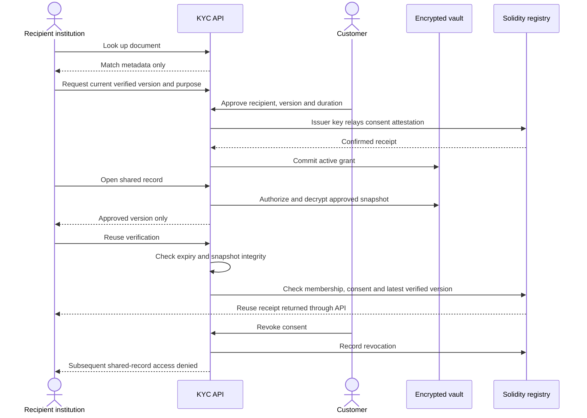
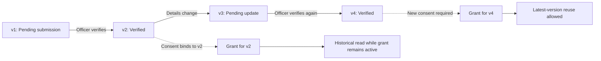
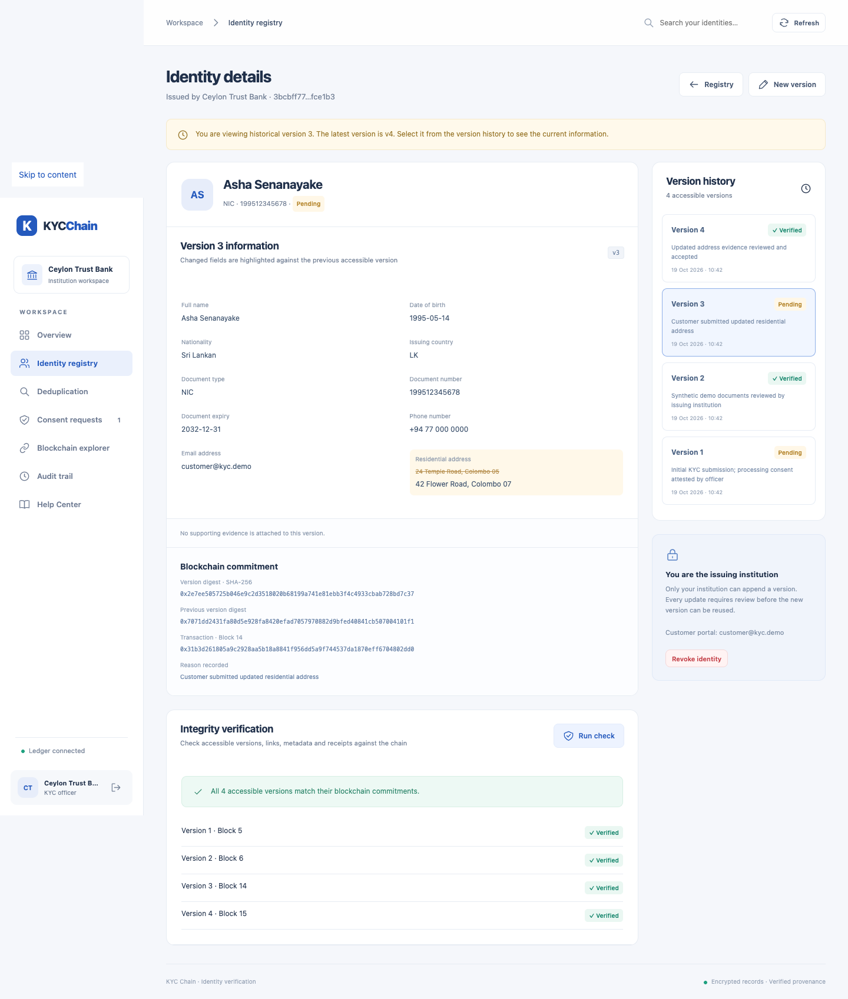

# KYC Chain

### Blockchain-Based Cross-Institutional KYC Deduplication and Versioning Framework for Identity Verification

A **Business Information Systems final-year project** implementing shared KYC discovery, immutable identity version history, and customer-controlled verification reuse across institutions.

**Status:** working application and hardened self-hosted pilot. The deployed ledger uses one Besu validator; independent consortium governance and regulated production assurance remain future work.

[Hosted application](https://kyc.dilanp.duckdns.org) · [Help Center](https://kyc.dilanp.duckdns.org/help/) · [Architecture](docs/ARCHITECTURE.md) · [API](docs/API.md) · [Deployment](docs/DEPLOYMENT.md)



*Institution workspace with fictional institutions and synthetic customer records from the training environment. The hosted application starts with an empty tenant.*

## The problem

When a customer joins several financial institutions, each institution may collect and verify the same identity documents separately. Disconnected records make it difficult to discover an existing verification, track which details changed, or establish whether another institution is relying on an outdated version.

Sharing entire customer files introduces another problem: a recipient may obtain personal information before the customer authorizes access. A shared database alone also leaves the history of updates under the control of its operator.

This project investigates four connected needs:

| Business problem | Framework response |
| --- | --- |
| Repeated onboarding for the same document | Detect an existing document using a normalized, keyed fingerprint |
| Personal details exposed during discovery | Return match metadata before consent; release the approved snapshot only after authorization |
| Overwritten records and stale verifications | Preserve every change as a new version with a predecessor digest and ledger commitment |
| Unclear sharing and reuse history | Record version-specific consent attestations and verification-reuse transactions |

The research question is whether these controls can support accountable reuse while keeping identity contents off-chain. Reduced onboarding time and cost are intended benefits to evaluate, **not measured outcomes claimed by this implementation**.

## The solution

An issuing institution registers a customer and attests to a verified snapshot. Another member institution can discover that a record exists, request access for a stated purpose, and reuse the latest verification after the customer approves. Updates create new versions, so an earlier approval cannot silently authorize reuse of changed information.

| Workspace | Responsibilities |
| --- | --- |
| Institution officer | Register identities, check duplicates, verify owned records, compare versions, request sharing and reuse authorized verification |
| Customer portal | Review requests, approve an exact version for a recipient and duration, reject requests and revoke access |
| Consortium administrator | Onboard institutions and inspect consortium metadata; no profile access through administrator record endpoints |

Operational guidance lives in the separate **Help Center**. The synthetic five-minute scenario and training credentials live only in the [training guide](docs/TRAINING.md), outside the main workspace.

## System architecture



The browser receives neither encryption keys nor institution signing keys. The hosted app and ledger expose no host HTTP/RPC ports; an existing reverse proxy handles HTTPS. Local training uses embedded Ganache instead of Besu.

### Technology stack

| Layer | Implementation |
| --- | --- |
| Frontend | Responsive HTML, CSS and vanilla JavaScript; no frontend build step |
| API and workflows | Node.js 22.13+, Express 5, ethers 6 |
| Data storage | Built-in Node SQLite, relational constraints, encrypted identity snapshots |
| Cryptography | HMAC-SHA-256 document index, SHA-256 commitments, AES-256-GCM snapshot encryption, scrypt passwords |
| Smart contract | Solidity 0.8.37 compiler, London EVM target |
| Ledger | Besu 26.9.0 QBFT for hosting; Ganache for isolated training/tests |
| Hosting | Multi-stage Docker image, Docker Compose, HTTPS reverse proxy |
| Validation | Node test runner and Playwright browser workflows |

### What is stored where?

| Data | Storage and protection |
| --- | --- |
| Full KYC profiles and uploaded PDF/PNG/JPEG evidence | AES-256-GCM encrypted snapshots in SQLite; evidence limit 2 MB |
| Document matching reference | HMAC fingerprint indexed off-chain and used as an opaque on-chain reference |
| Version history proof | On-chain digest, previous digest, issuer, version, status and timestamp |
| Consent | On-chain recipient, version, expiry and active flag; purpose and workflow metadata off-chain |
| Verification reuse | On-chain reuse event plus an off-chain receipt reference |
| Account names/emails, requests and audit metadata | Ordinary off-chain database columns; not covered by snapshot encryption |
| Passwords and sessions | Salted scrypt password hashes and hashed session tokens |
| Encryption and signing material | Private runtime files, excluded from this repository |

A ledger commitment can reveal that a stored snapshot has changed. It cannot establish that the original identity information was truthful. The current host operator controls both the application keys and the single validator, so this deployment does not provide independent institutional trust.

## Core workflows

### 1. Discover an existing document

The service normalizes the document number using Unicode NFKC, uppercase conversion and removal of spaces/hyphens. It combines the result with issuing country and document type, then computes a keyed HMAC-SHA-256 fingerprint.

The unique index prevents registering the same document twice. Before consent, a match returns only record reference, issuer, current version/status and access flags. It does not return the person's name, address, birth date, evidence or full document number.



*Illustration uses a synthetic document number. Exact document matching does not link a person's different passports or identity cards.*

### 2. Share and reuse with consent



Customer approval is authenticated by the application and relayed with the issuer's signing key. It is not an independently customer-signed blockchain transaction. Revocation blocks future application access; it cannot recall previously downloaded information.

### 3. Preserve versions and prevent stale reuse



Every verification is itself a new immutable version. A change creates a pending version and immediately prevents reuse of the older verification as current. An active older grant may still permit reading its historical snapshot until expiry or revocation; it does not permit reading the new version. A final identity revocation removes recipient access to all versions.

Each snapshot includes its predecessor digest and a random nonce. Integrity checking compares decrypted content, recomputed digests, version linkage, contract state and transaction receipts.



*The version comparison above uses fictional customer data.*

### 4. Recover interrupted writes

SQLite and the blockchain cannot share an atomic transaction. Before broadcasting, the service persists the signed transaction, its deterministic hash and intended database changes in a durable outbox. After confirmation, it applies the changes and marks the outbox entry committed in one database transaction.

On restart, prepared transactions are reconciled before traffic is accepted. This avoids silently creating duplicate versions after an interrupted commit. The current mutation queue and signing strategy support a **single application process**; horizontal scaling needs additional coordination.

## Run locally

Prerequisites: **Node.js 22.13 or newer**, npm and Git. No browser wallet, public-chain balance, paid API or separate database is required for local use.

```sh
git clone https://github.com/ISMR-Labs/kyc-chain.git
cd kyc-chain
npm ci
npm start
```

Open **http://127.0.0.1:4310**. A fresh data directory generates an administrator account; read the private `data/bootstrap-admin.txt` file locally for its credentials. Replace the temporary password on first sign-in, then onboard institutions through Blockchain explorer. Existing runtime data is preserved.

For a separate synthetic training environment:

```sh
SEED_DEMO=true DATA_DIR=./data-training PORT=4311 npm start
```

Open **http://127.0.0.1:4311** and follow [Training setup and walkthrough](docs/TRAINING.md). Production mode rejects demo seeding. No email sender is configured; generated temporary credentials must be delivered to their intended recipients separately.

### Configuration

| Variable | Purpose |
| --- | --- |
| `DATA_DIR` | Persistent private vault, keys and local ledger state; defaults to `./data` |
| `HOST`, `PORT` | Local HTTP binding; defaults to `127.0.0.1:4310` |
| `SEED_DEMO` | Explicitly enable synthetic training fixtures in a new dataset |
| `NODE_ENV` | `production` enables hosted startup safeguards |
| `PUBLIC_ORIGIN` | Canonical HTTPS origin required for production |
| `TRUST_PROXY` | Trusted reverse proxy address used for forwarded HTTPS handling |
| `ADMIN_EMAIL` | Initial administrator email for a fresh deployment |
| `RPC_URL` | Private external EVM JSON-RPC endpoint; required for normal production startup |

Environment values are read from the process; no automatic `.env` loader is installed. Docker Compose receives deployment settings through its `--env-file` option. Keep one application process per data directory.

## Tests and validation

```sh
npm run check
npm run compile
npx playwright install chromium
npm test
```

On macOS, the browser tests use installed Google Chrome when available. Otherwise they use Playwright Chromium; `BROWSER_PATH` can select another Chromium executable. Linux CI may need `npx playwright install --with-deps chromium`.

All **21 automated checks passed** on 19 October 2026, alongside JavaScript syntax checks and Solidity compilation.

The suite covers browser workflows, duplicate privacy, customer consent, stale reuse rejection, role authorization, snapshot cryptography, smart-contract checks, outbox recovery, HTTPS requirements, password rotation, persistent sessions and separate Help pages. Tests use isolated temporary databases and ledgers. Browser screenshots are generated under ignored `artifacts/screenshots/`.

Runtime dependencies are separate from development/training dependencies:

```sh
cd deploy
npm audit --omit=dev
```

Ganache's training dependency tree has known advisories and is excluded from the hosted application image. Dependency audit results are time-dependent and do not replace an application security assessment.

## Deployment and operations

The repository includes the application Dockerfile, private Besu Compose service, genesis preparation, reverse proxy configuration, backup scripts, operator password recovery and deployment checks.

Use [Deployment and recovery](docs/DEPLOYMENT.md) for the deployed topology and maintenance procedure. **The installation and maintenance scripts contain the current host's paths, domain and proxy-network settings.** Review and adapt those settings before using them on another server; Compose alone does not provision the reverse proxy, certificates or ledger genesis.

Back up the vault, keys and ledger together. The backup script stops both services to produce a consistent recovery point, then restores their previous running state. Runtime databases, keys, generated passwords, environment files and backups are intentionally absent from GitHub.

## Repository layout

```text
contracts/                 Solidity identity, consent and reuse registry
server/                    API, authorization, cryptography, storage and ledger adapter
public/                    Browser workspaces and separate Help Center
scripts/                   Contract compilation, ledger preparation and operational checks
deploy/                    Compose, runtime/compiler lockfiles, proxy and maintenance scripts
tests/                     Browser, API, contract, recovery and deployment checks
docs/                      Architecture, API, training, deployment and research notes
  images/                  Reviewed application screenshots using synthetic data
Dockerfile                 Separate compiler and application runtime stages
package.json               Local development and validation commands
```

## Documentation

| Guide | Contents |
| --- | --- |
| [Help Center](https://kyc.dilanp.duckdns.org/help/) | Officer, customer and administrator instructions; also served locally at `/help/` |
| [Architecture and trust model](docs/ARCHITECTURE.md) | Data model, cryptography, access rules, state transitions and recovery |
| [API reference](docs/API.md) | Authentication, endpoints, request payloads and responses |
| [Training walkthrough](docs/TRAINING.md) | Isolated synthetic dataset and presentation scenario |
| [Deployment and recovery](docs/DEPLOYMENT.md) | Containers, proxy, backups, restore and password recovery |
| [BIS FYP notes](docs/FYP-NOTES.md) | Research framing, evaluation ideas and viva preparation |

## Scope and next steps

This implementation demonstrates the complete discovery → consent → version-specific sharing → reuse → update/revocation cycle. It is a pilot, not a certified banking KYC service.

Before regulated use, the remaining work includes independent institution-operated validators and signing-key custody, independently verifiable customer signatures, reviewed identity-proofing integrations, MFA, key rotation, security and smart-contract assessments, retention governance, monitoring and off-site recovery.

Verification currently means an officer attestation; no government registry, biometrics, OCR or document-forensics integration is included. Audit reads remain mutable off-chain, and the host operator is trusted. These boundaries are part of the research model and should remain explicit in evaluation and presentations.
