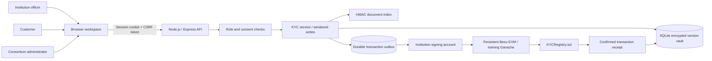
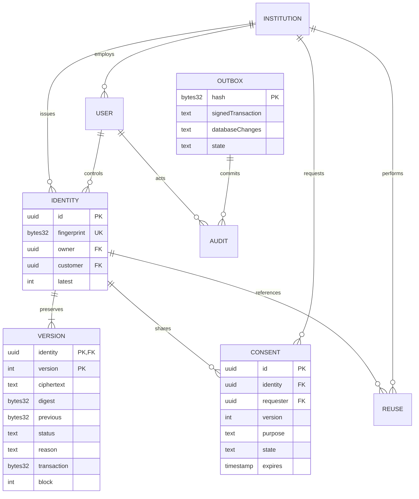
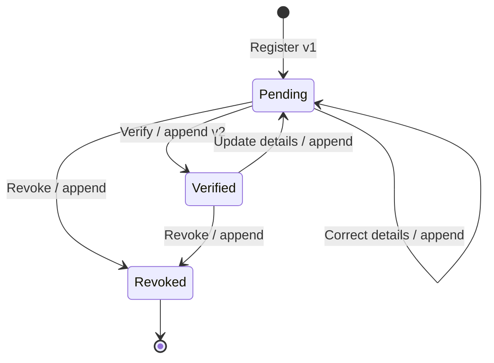
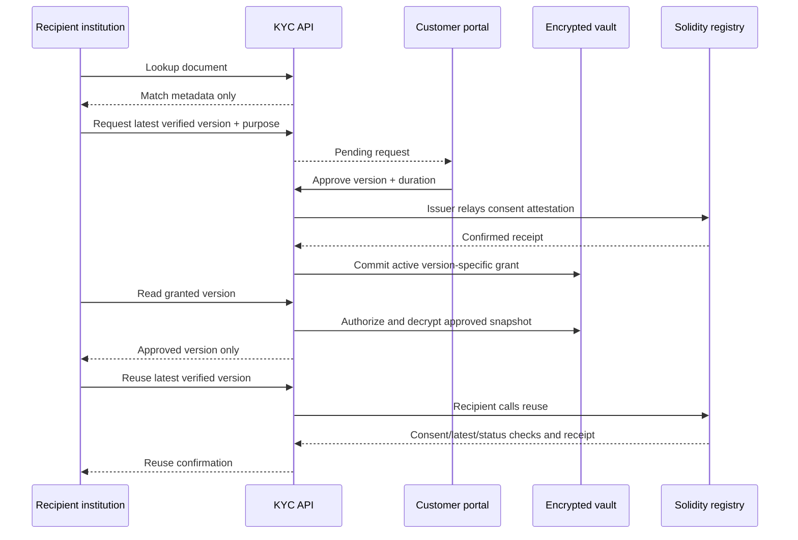

# Architecture and trust model

## Deployment profiles

The hosted deployment uses a private Besu 26.9.0 QBFT node over an internal Docker network, with a single validator. The app uses a JSON-RPC provider and deterministically derived institution signing accounts funded at genesis. Ganache is dynamically loaded only for local training and isolated tests. The hosted runtime image excludes Ganache and solc; a separate build stage compiles the contract for the London EVM target.

The web service is exposed only through the existing HTTPS reverse proxy. No application HTTP port or ledger RPC port is published on the host. Production starts with a generated administrator, requires first-login password replacement, and refuses a seeded training database. Refer to `DEPLOYMENT.md` for the actual service topology.

## Components



The browser does not hold vault keys or blockchain private keys. The hosted JSON-RPC listener is confined to the internal ledger network. Training uses an embedded EIP-1193 provider. Local development uses loopback by default. In Docker, HTTP is reachable only by the reverse proxy network.

## Roles

| Action | Issuing officer | Other member officer | Linked customer | Administrator |
| --- | --- | --- | --- | --- |
| Register an identity | Yes | Yes, as its new issuer | No | No |
| Exact document lookup | Yes | Yes | No | No |
| View identity versions | All versions owned | Only actively consented version | Own versions | No |
| Append/update/verify/revoke | Own identities | No | No | No |
| Request sharing | Not needed for owned records | Yes, latest verified record | No | No |
| Approve/reject/revoke sharing | No | No | Own identity only | No |
| Reuse verification | Not needed for owned records | Current verified version with consent | No | No |
| Onboard institution | No | No | No | Yes |
| Audit visibility | Own institution and owned identities | Own institution | Own activity/identities | Consortium metadata |

Administrator access is intentionally metadata-oriented; it does not grant decryption through the record endpoints. Because the administrator of the actual host controls local files and encryption keys, this is an application authorization boundary, not protection against a hostile host administrator.

## Data model



Other tables store users (scrypt password hashes), institutions (member address and signing slot), reuse receipts, audit events and runtime settings. Foreign keys and primary/unique keys enforce relational consistency.

## Deduplication

1. Normalize a document number using Unicode NFKC, uppercase conversion and removal of spaces and hyphens.
2. Validate an alphanumeric result; validate the country and document type.
3. Serialize `[issuingCountry, documentType, normalizedNumber]` canonically.
4. Compute `HMAC-SHA-256(indexKey, serialization)`.
5. Query the unique fingerprint index. The contract uses the same opaque 32-byte reference.

An exact match returns only record ID, issuer, current version/status and access flags. It does not return name, address, birth date, evidence or full document number. The create operation always repeats the match check and is serialized with other writes; the database also has a unique constraint.

Including country and type avoids conflating the same number from unrelated document namespaces. A keyed fingerprint avoids using an unkeyed low-entropy document hash, although the centralized matching service can still perform guesses and observe equality. This is **not** a zero-knowledge protocol. A distinct passport and NIC for the same individual remain distinct identities.

## Version commitments

Each snapshot contains:

```text
identity UUID
version integer
previous digest
status
reason
creation timestamp
complete KYC profile and optional evidence bytes
random 32-byte nonce
```

Keys are sorted recursively before JSON serialization. The snapshot digest is SHA-256 of this canonical serialization. The random nonce increases resistance to guessing the contents of a low-entropy profile from a commitment alone. The snapshot is encrypted with AES-256-GCM using a random 12-byte IV and `identityId:version` as authenticated additional data. Moving ciphertext between identities or versions fails authentication.

The contract stores only the identity reference, issuer, monotonically increasing version count, digest, previous digest, status and block timestamp. Its event log stores version, consent and reuse events. The database stores the matching transaction hash and block number.

Every verification is itself a new immutable version, even if the profile fields did not change. A new edit appends a pending version; an officer must attest again before reuse. Document identity fields are immutable after registration. Revocation appends a final version and closes the identity to further changes in this prototype.



The integrity endpoint checks GCM decryption, recomputed digest, authenticated metadata, predecessor linkage, on-chain status, latest version and issuer, and the transaction receipt/event for every accessible version. It checks whether stored data agrees with its historical commitment; it does not prove that the submitted data was truthful.

## Consent and reuse



One active grant per identity/recipient is represented on-chain. Approving a replacement revokes prior approved rows for the same pair. The requested purpose is off-chain; the chain stores only a version, recipient, expiry and active flag.

An old approved snapshot remains readable until that consent expires or is revoked, even after a newer version exists. It is clearly displayed as historical. Reuse requires the latest version. A revoked identity removes recipient access to all snapshots, regardless of old grants. The customer and issuer retain historical access.

The application additionally checks document expiry before verification/reuse. The contract does not see document dates, because profiles are off-chain. Therefore this check is a backend trust responsibility. Blockchain consent expiry is checked by block time; application expiry is checked by server time. A real deployment needs monitored clock synchronization.

Consent approval is **not independently signed by a customer wallet**. The server authenticates the customer and relays the attestation with the issuer’s signing account. An independently verifiable customer-signature scheme is a future extension.

## Coordinating database and blockchain writes

The two stores cannot participate in one ACID transaction. The prototype uses a durable outbox:

1. Serialize mutations through one process-wide queue.
2. Validate permissions, expected version and business rules.
3. Prepare a signed transaction and its deterministic transaction hash.
4. Persist the signed transaction and pending SQL mutations as a `prepared` outbox row before broadcast.
5. Broadcast and await a successful receipt.
6. Apply the SQL mutations and mark the outbox row `committed` in one SQLite transaction.
7. On restart, find prepared rows, inspect/broadcast the same signed transaction, and commit their database changes once confirmed.

If a write fails after preparation, further chain writes are blocked for that process until recovery on restart. This avoids advancing database state without confirmed chain evidence or silently generating duplicate transactions. Failed/reverted transactions are marked failed. The automated recovery test intentionally causes a SQL commit failure after mining and verifies that restart restores consistency without another version append.

This is a single-process design. Horizontal scaling would need a shared coordinator and stronger nonce/locking strategy. A crash during initial contract deployment may leave an unused orphan contract; no application data has been attached at that stage. This prototype does not address hostile chain reorganization or Byzantine validators.

## Security scope

- Server-side authorization on every data read and mutation.
- HttpOnly, SameSite=Strict session cookies; Secure when served over HTTPS.
- Hashed session tokens in SQLite, with eight-hour absolute expiry and 30-minute idle expiry. Password rotation invalidates prior sessions; controlled restarts preserve valid sessions.
- CSRF token and same-origin write checks.
- Parameterized SQLite statements and a serialized mutation queue.
- scrypt password hashes with random salts; login throttling by IP/email.
- Escaped UI text, a restrictive CSP, safe CSV formula handling and attachment-only evidence downloads.
- Evidence MIME allowlist, magic signature checks and upload size limits. This is not malware scanning.
- Random local encryption/index/chain seeds in an owner-readable key file; ignored runtime state.

Plaintext account metadata and workflow metadata still exist in SQLite. Access logs are mutable local data. Local host operators control keys and the development chain. Production work requires independent key custody, customer signatures, a reviewed privacy model, rate-limit/abuse protection, identity proofing, operational controls, independent validators, contract review and suitable recovery governance.
